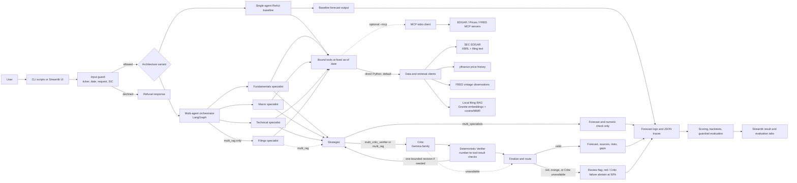

# Equity Forecaster Architecture

This document describes the implementation in `forecaster/`, `scripts/`, and `ui/` as it exists today. It distinguishes working components from planned course designs.

## Architecture block diagram



## Request flow

```mermaid
sequenceDiagram
    actor User
    participant Entry as CLI / Streamlit
    participant Guard as Input guard
    participant Graph as LangGraph orchestrator
    participant Spec as Specialists
    participant Tools as Tool layer
    participant Data as SEC / FRED / prices / RAG
    participant Judge as Strategist + Critic
    participant Verify as Deterministic Verifier
    participant Store as Logs and evaluation files

    User->>Entry: ticker, as-of date, optional question, variant
    Entry->>Guard: validate request and company SIC
    alt Invalid, advice, execution, injection, future date, or unsupported financial company
        Guard-->>Entry: refusal; no model or forecast-data calls
    else Allowed
        Entry->>Graph: run(ticker, as_of, variant)
        par Fundamentals / macro / technical (+ filings for multi_rag)
            Graph->>Spec: start specialists with fixed as-of date
            Spec->>Tools: call allowed tools
            Tools->>Data: direct Python calls or MCP server calls
            Data-->>Tools: dated observations, filings, and calculated indicators
            Tools-->>Spec: tool output with source metadata
            Spec-->>Graph: structured findings and explicit gaps
        end
        Graph->>Judge: merge findings and ask for probability, evidence, risks
        Judge-->>Graph: structured draft
        Graph->>Judge: Critic checks draft against findings
        Judge-->>Graph: accept / revise, or unavailable
        Graph->>Verify: check draft numbers against collected tool results
        alt Revision needed and budget remains
            Verify-->>Graph: unsupported numbers or Critic issue
            Graph->>Judge: one bounded revision request
            Judge-->>Graph: revised draft
            Graph->>Verify: check revised draft
        else No revision
            Verify-->>Graph: verification status
        end
        alt Verifier red or Critic unavailable in routed variants
            Verify-->>Graph: abstain at 50%; mark review_required when Critic unavailable
        else Otherwise
            Verify-->>Graph: retain draft; drop unsupported text and flag orange for review
        end
        Graph-->>Entry: forecast, trace, gaps, and disclaimer
        Entry->>Store: save run trace; append forecast when requested
    end
```

The sequence below details the routed variants (`multi_critic_verifier` and `multi_rag`). `multi_specialists` stops after the Strategist and reports numeric verification without routing or revision. The single-agent variant uses the separate ReAct loop in `forecaster/baseline.py`.

## Component contracts and boundaries

- `forecaster/variants.py` applies the request guard and selects one of four variants: `single_agent_react`, `multi_specialists`, `multi_critic_verifier`, or `multi_rag`.
- `forecaster/agent.py` implements a bounded ReAct tool loop. Tool schemas restrict each agent's available actions; tool errors are returned as observations.
- `forecaster/multi_agent.py` uses deterministic graph logic to fan out fundamentals, macro, and technical work in parallel; the orchestrator does not make an LLM planning call. The analyst/news role is currently a stub with an explicit missing-source gap. `multi_rag` adds a filing-text specialist. A Strategist generates the forecast; the Critic reviews it; the Verifier checks numeric claims.
- `forecaster/tools.py` injects the as-of date into tool callables. The model is not allowed to select the date. The optional MCP backend exposes the same read-only tools through three local stdio servers.
- `forecaster/data/` reads SEC XBRL and filing records, adjusted price history, and FRED vintage-aware macro data. `forecaster/indicators.py` and `forecaster/macro.py` compute indicators, trade-timing levels, and company-specific macro relevance in code.
- `forecaster/rag.py` extracts 10-K/10-Q risk-factor and MD&A text, chunks it, embeds it with the configured local embedding model, filters candidates by similarity, and uses MMR to diversify passages. Retrieved filing text is treated as untrusted input and scanned by `forecaster/guard.py`.
- `forecaster/verifier.py` checks numeric statements against values returned by tools and filing passages. It does not independently establish that the text citation is authentic or that a cited source supports a non-numeric claim.
- The forecast log is used for outcome scoring and evaluation. Historical forecasts or lessons are not retrieved into the next forecast; the cross-run learning described in early checkpoints remains future work.
- `scripts/` runs live forecasts, universe runs, historical backtests, scoring, guardrail evaluation, and figures. `ui/app.py` displays forecasts and stored evaluations; its review flag is informational and is not a staffed human-review queue.

## Failure and fallback behavior

- Invalid or unsafe requests return a refusal before model/forecast-data execution. The sector guard may make a small SEC company-profile lookup; SIC screening is skipped if that metadata cannot be obtained.
- Specialist tool/model errors are retained as gaps; a specialist with no valid JSON contributes no findings. A missing analyst/news integration is explicit.
- Invalid Strategist JSON receives one formatting repair attempt. The workflow has one revision cycle; it does not loop indefinitely.
- A red numeric-verification result resets the routed forecast to a neutral 50% abstention. Orange results remove evidence/risk items containing unverified numbers, withhold the rationale if it contains such numbers, and set a human-review flag. Green means the numeric checks passed, not that the forecast is correct.
- If the Critic errors or returns malformed JSON, the routed pipeline now abstains at 50% and marks `review_required`; the UI explains the reason. No reviewer queue or approval workflow is connected yet.
- Data calls can still fail because an external API, local Ollama model, embedding model, or MCP server is unavailable. The trace records run and tool information, but the project does not yet implement automatic human escalation or production service-level monitoring.

## Deliberate scope limits

Tree-of-Thought search from the Module 4/Checkpoint 4 design is not present in the current runtime: the Strategist makes one structured generation, with at most one revision after review. Analyst ratings and news are not connected. The multi-agent variants do not include a general conversational follow-up memory. Technical indicators support entry timing and are instructed not to determine direction. The system is read-only for market/company data and only writes local run and forecast records; it has no brokerage integration.
